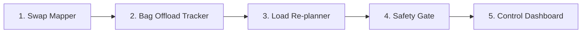

# Aircraft Swap Re-planner · Toronto Pearson (YYZ)

When a plane has a mechanical problem shortly before departure, the airline swaps in a smaller one. Passengers are already seated and bags and cargo are already being loaded, but the smaller plane has fewer seats, smaller holds and different balance limits. **The old loading plan is now wrong.**

This project is an **equipment-swap re-planning module**. It takes the flight as it is right now and quickly produces a safe new loading plan that **changes as little as possible**, tells each person what to do, and **explains why**.

> Not a certified weight-and-balance system. Aircraft numbers are illustrative. The goal is to show how smarter re-planning improves decisions in the minutes before departure. A qualified load controller still approves every plan.

**Scope:** we do **not** decide which passengers fly. The airline's departure control system (DCS) sends us the list of removed passengers. Everything after that is ours.

## Workflow

| # | Subsystem | Job |
|---|---|---|
| 1 | **Swap Mapper** | Put passengers onto the new plane and find who doesn't fit |
| 2 | **Bag Offload Tracker** | Find every bag, pull the ones whose owner was removed, flag bags at risk |
| 3 | **Load Re-planner** | Decide which hold each bag and cargo item goes in, safely, with the fewest changes |
| 4 | **Safety Gate** | Check weight, balance and counts, then release, block or send for review |
| 5 | **Control Dashboard** | Show the answer and the reasons, so a human can approve |

Each subsystem has a **basic version** (must have) and a **stronger version** (if time). A complete basic version of all five beats a half-built stronger one.

---

## 1 · Swap Mapper

**Job:** map the old plane's passenger list onto the new plane.

**Input**
- Passenger list: seat, row, category (adult male / adult female / child), removed flag from the DCS
- New aircraft data: cabin zones with row ranges, seats per zone, position (arm), max weight
- Season (summer or winter)

**Output**
- Number of passengers and total weight per cabin zone
- "Doesn't fit" list: passengers whose seat doesn't exist on the new plane, sent to the DCS

**Should have (basic)**
- Seat row → cabin zone on the new plane
- Rows that don't exist on the new plane go on the "doesn't fit" list
- Weight per zone from Transport Canada standard weights (summer/winter)

**Nice to have (stronger)**
- No-show risk for passengers not yet at the gate, giving a weight range instead of one number
- Flag large groups seated together in one zone ("group of 12 in rows 24–26 pulls the balance aft")
- A safety buffer on weights when margins are thin

**Explains why, e.g.:** "30 passengers in rows 28–32 have no seat on the A320: sent to DCS."

**Tasks**
- [ ] Map each seat to a cabin zone on the new aircraft
- [ ] Build the "doesn't fit" list
- [ ] Calculate passenger weight per zone (summer and winter)
- [ ] *(stronger)* Add check-in / at-gate status and a no-show weight range
- [ ] *(stronger)* Detect groups seated together and flag their effect on balance

## 2 · Bag Offload Tracker

**Job:** know where every bag is, pull the right ones, and flag anything that puts departure at risk.

**Input**
- Bag list: tag, owner, weight, location (cart / hold / inbound), position in stack, connecting flag, arrival time
- List of removed passengers
- Loading cutoff time

**Output**
- Ordered pull list: which bags to remove, where they are, in what order
- Status of every bag
- Connecting bags at risk of missing the flight
- Bag count check: loaded + pulled + left behind = bags checked

**Bag states:** `on cart` → `in hold` → `loaded` · `inbound` → `arrived` · `to pull` → `pulled` · `at risk` (won't arrive before cutoff)

**Should have (basic)**
- Every bag of a removed passenger goes on the pull list
- Pull order: carts first, then holds, then inbound bags (stop at transfer); top of each stack first
- Every bag accounted for

**Nice to have (stronger)**
- Connecting bags flagged at risk if they arrive after the cutoff
- Reserve hold space for likely late bags
- Simulated scan feed that moves bags through the states live

**Explains why, e.g.:** "Pull AC100196 first: top of cart 1." · "AC100150 is at risk: arrives 12 min after cutoff."

**Tasks**
- [ ] Find all bags belonging to removed passengers
- [ ] Order the pull list by location and stack position
- [ ] Track the state of every bag
- [ ] Count check: every bag accounted for
- [ ] *(stronger)* Flag connecting bags at risk
- [ ] *(stronger)* Simulated scan feed

## 3 · Load Re-planner

**Job:** decide which hold each remaining bag and cargo item goes in. This is the optimisation part.

**Input**
- Passenger weight per cabin zone (from Swap Mapper)
- Bags still flying, with their current hold if already loaded (from Bag Offload Tracker)
- Cargo: weight, priority (1 = most important), category (mail, medical, perishable, dangerous goods, general), current hold
- New aircraft limits: hold max weight and volume, max zero-fuel weight, CG limits, target CG
- Options: season, lightning mode, safety buffer

**Output**
- Hold for every bag and cargo item
- Move list: items that must change hold
- Cargo bumped, lowest priority first
- Final weight and CG
- Reasons: one plain sentence per move and per bumped item

**Should have (basic)**
- **Hard rules (never broken):** hold weight and volume limits, max zero-fuel weight, CG between the forward and aft limits, dangerous goods only in allowed holds
- **Goals, in strict order:**
  1. Leave no bags behind
  2. Bump the least important cargo
  3. Move the fewest items that are already loaded
  4. Keep the CG near the fuel-efficient target
- **Lightning mode:** fewest moves comes before cargo, so loading restarts fast after a lightning hold

**Nice to have (stronger)**
- Safety buffer: plan stays safe even if passenger weights are off (robust optimisation)
- Comparison: "our plan vs. re-plan from scratch" (number of moves)
- What-if: "+N passengers fit in zone X", "move 10 passengers aft"
- Backup method if the solver fails

**Explains why, e.g.:** "Forward hold is 481 kg over its A320 limit → moved auto parts to aft (1 move)." · "E-commerce pallet bumped: lowest priority, needed for the winter safety buffer."

**Tasks**
- [ ] Build the optimisation model with the hard rules
- [ ] Solve the four goals in order
- [ ] Lightning mode
- [ ] Generate the reasons list
- [ ] *(stronger)* Safety buffer
- [ ] *(stronger)* Re-plan-from-scratch comparison
- [ ] *(stronger)* What-if margins
- [ ] *(stronger)* Backup method

## 4 · Safety Gate

**Job:** decide whether the plan can go to the load controller for sign-off.

**Input**
- The plan from the Load Re-planner
- The airline's counts: passengers boarding, bags checked

**Output**
- One status plus the reasons

| Status | Means | Example reason |
|---|---|---|
| `SAFE` | All limits met, all counts match. Ready for a human to approve | — |
| `UNSAFE` | No plan can meet the limits | "Too heavy at the front: no arrangement keeps the CG behind 16.4 m" |
| `BLOCKED` | Counts don't match between systems | "DCS says 161 passengers, cabin has 162" |
| `NEEDS REVIEW` | Safe, but close to a limit or with bags left behind | "CG margin under 0.2 m" · "3 bags cannot fly" |

**Should have (basic):** `SAFE` / `UNSAFE` / `BLOCKED` with reasons. Never report an unsafe plan as safe.

**Nice to have (stronger):** `NEEDS REVIEW` for thin margins; a confidence score; an audit log of every plan and who approved it.

**Tasks**
- [ ] Recalculate weight and CG on the final plan
- [ ] Passenger and bag count check against the DCS
- [ ] Status and reasons
- [ ] *(stronger)* `NEEDS REVIEW` status
- [ ] *(stronger)* Approve button and audit log

## 5 · Control Dashboard

**Job:** answer three questions at a glance: **Is it safe? What has to happen? Why?**

**Input:** the full result from subsystems 1–4.

**Output (what the operator sees)**
- Status banner with reasons
- CG chart: before vs. after, inside the safe area
- Hold fill bars (weight vs. limit)
- Pull list, move list, cargo bumped, connecting bags at risk
- "Why" panel with the reasons
- Switches: winter/summer, safety buffer, lightning mode

**Should have (basic):** banner, CG chart, hold bars, pull list, move list, cargo bumped, switches. Works offline.

**Nice to have (stronger):** "why" panel, plan comparison, live scan feed, approve button, export of the pull list.

**Tasks**
- [ ] Scenario picker and "Re-plan" button
- [ ] Status banner
- [ ] CG chart (before vs. after)
- [ ] Hold fill bars
- [ ] Pull list, move list and cargo bumped tables
- [ ] Count check panel
- [ ] Winter/summer, safety buffer and lightning switches
- [ ] *(stronger)* "Why" panel
- [ ] *(stronger)* Comparison, approve button, export

---

## Demo scenario

A321 → A320 swap on a winter evening at Pearson. The A320 has 5 fewer rows, so the DCS removes the 30 passengers in rows 28–32. The A321's forward hold was loaded first and is now over the A320's forward-hold limit.

| Demo moment | What it should show |
|---|---|
| Re-plan | Safe plan in about a second, very few items moved |
| From-scratch comparison | Many more items moved without our approach |
| Winter + safety buffer | Lowest-priority cargo bumped |
| Lightning mode | Fewest moves, with a different cargo trade-off |
| Wrong passenger count | Load sheet BLOCKED with the reason |

## Assumptions

- Units: kilograms and metres from the nose
- Aircraft data is illustrative, shaped like A320/A321 values
- Passenger weights: Transport Canada standard weights (summer/winter)
- The DCS decides who flies; a human load controller approves every plan

## Definition of done

- **Basic (must):** all 5 subsystems work end to end on the demo flight, offline. The dashboard shows safe/unsafe, the plan, the pull list and the reasons.
- **Stronger (pick at most 2):** safety buffer with the summer/winter story · connecting bags at risk · `NEEDS REVIEW` + approve button. Each needs a clear demo moment.
