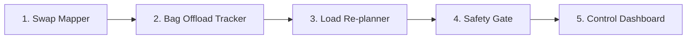

# Aircraft Swap Re-planner · Toronto Pearson (YYZ)

When a plane has a mechanical problem shortly before departure, the airline swaps in a smaller one. Passengers are already seated and bags and cargo are already being loaded, but the smaller plane has fewer seats, smaller holds and different balance limits. **The old loading plan is now wrong.**

This project is an **equipment-swap re-planning module**. It takes the flight as it is right now and quickly produces a safe new loading plan that **changes as little as possible**, tells each person what to do, and **explains why**.

> Not a certified weight-and-balance system. Aircraft numbers are illustrative. The goal is to show how smarter re-planning improves decisions in the minutes before departure. A qualified load controller still approves every plan.

**Scope:** we do **not** decide which passengers fly. The airline's departure control system (DCS) sends us the list of removed passengers. Everything after that is ours.

## Run the combined dashboard

From the `d2/` directory:

```bash
python -m pip install -r combined_code/requirements.txt
python -m streamlit run combined_code/dashboard.py
PYTHONPATH=combined_code python -m unittest discover -s combined_code/test -v
```

The submitted combined-code test suite was run successfully: **11 tests passed**. It covers passenger mapping, bag reconciliation, load planning, safety checks, and end-to-end SAFE, BLOCKED, and UNSAFE scenarios.

## Workflow



| # | Subsystem | Job |
|---|---|---|
| 1 | **Swap Mapper** | Put passengers onto the new plane and find who doesn't fit |
| 2 | **Bag Offload Tracker** | Find every bag, pull the ones whose owner was removed, flag bags at risk |
| 3 | **Load Re-planner** | Decide which hold each bag and cargo item goes in, safely, with the fewest changes |
| 4 | **Safety Gate** | Check weight, balance and counts, then release, block or send for review |
| 5 | **Control Dashboard** | Show the answer and the reasons, so a human can approve |

---

## 1 · Swap Mapper

**Job:** map the old plane's passenger list onto the new plane.

**Input**
- Passenger list: seat, row, category (adult male / adult female / unspecified adult / child / infant), removed flag from the DCS
- New aircraft data: cabin zones with row ranges, seats per zone, position (arm), max weight
- Season (summer or winter)

**Output**
- Number of passengers and total weight per cabin zone
- "Doesn't fit" list: retained passengers with no valid seat on the new plane, sent to the DCS

**What it does**
- Skips passengers the DCS has removed
- Seat row → cabin zone on the new plane
- Invalid rows, invalid seat letters, missing seats and duplicate seats go on the "doesn't fit" list
- Places lap infants with a mapped parent or guardian, without using a seat
- Weight per zone from Transport Canada standard weights (summer/winter)

**Also built:** a safety buffer on passenger weights

**Not built yet:** no-show weight range, flags for large groups seated together

**Explains why, e.g.:** "Row 33 does not exist on the A320: sent to the DCS."

## 2 · Bag Offload Tracker

**Job:** know where every bag is, pull the right ones, and flag anything that puts departure at risk.

**Input**
- Bag list: tag, owner, weight, location (cart / hold / inbound), position in stack, connecting flag, arrival time
- List of removed passengers
- Loading cutoff time

**Output**
- Ordered pull list: which bags to remove, where they are, in what order
- Status of every bag
- Bags at risk of missing the flight
- Bag count check: loaded + pulled + left behind = bags checked

**Bag statuses:** `ok` · `inbound` (arrives before cutoff) · `to pull` · `at risk` (won't arrive before cutoff, or has no arrival time) · `unknown` (location not recognized)

**What it does**
- Bags of removed passengers go on the pull list. An inbound bag arriving after cutoff can't be intercepted in time, so it is counted as left behind
- Pull order: carts first, then holds, then inbound bags (stop at transfer); top of each stack first
- Every bag accounted for against the DCS count
- Connecting and inbound bags are flagged at risk if they arrive after the cutoff

**Not built yet:** reserved hold space for likely late bags, simulated scan feed

**Explains why, e.g.:** "Pull AC100196 first: top of cart 1." · "AC100150 is at risk: arrives 12 min after cutoff."

## 3 · Load Re-planner

**Job:** decide which hold each remaining bag and cargo item goes in. This is the optimisation part.

**Input**
- Passenger weight per cabin zone (from Swap Mapper)
- Bags still flying, with their current hold if already loaded (from Bag Offload Tracker)
- Cargo: weight, priority (1 = most important), category (mail, medical, perishable, dangerous goods, general), current hold, must-fly flag
- New aircraft limits: hold max weight and volume, max zero-fuel weight, CG limits, target CG
- Options: season, lightning mode, safety buffer

**Output**
- Hold for every bag and cargo item
- Move list: items that must change hold
- Cargo bumped, lowest priority first
- Final weight and CG
- Reasons: one plain sentence per move and per bumped item

**What it does**
- **Hard rules (never broken):** hold weight and volume limits, max zero-fuel weight, CG between the forward and aft limits, dangerous goods only in allowed holds, must-fly cargo stays on
- **Goals, in strict order:**
  1. Leave no bags behind
  2. Bump the least important cargo
  3. Move the fewest items that are already loaded
  4. Keep the CG near the fuel-efficient target
- **Lightning mode:** fewest moves comes before cargo, so loading restarts fast after a lightning hold
- **Solver results:** OPTIMAL, FEASIBLE (a plan exists but optimality was not proven), INFEASIBLE or ERROR

**Also built:** safety buffer, so the plan stays safe with heavier passenger weights

**Not built yet:** "our plan vs. re-plan from scratch" comparison, what-if margins, backup method if the solver fails

**Explains why, e.g.:** "Forward hold is 481 kg over its A320 limit → moved auto parts to bulk (1 move)." · "E-commerce pallet bumped: lowest priority, needed for the winter safety buffer."

## 4 · Safety Gate

**Job:** decide whether the plan can go to the load controller for sign-off.

**Input**
- The plan from the Load Re-planner
- The airline's counts: passengers boarding, bags checked

**Output**
- One status plus the reasons

| Status | Means | Example reason |
|---|---|---|
| `SAFE` | All limits met, all counts match. Ready for a human to approve | — |
| `NEEDS REVIEW` | Safe, but close to a limit, with bags left behind or with cargo bumped | "CG margin under 0.2 m" · "3 bags cannot fly" |
| `BLOCKED` | Counts don't match between systems | "DCS says 163 passengers, plan has 162" |
| `UNSAFE` | No plan can meet the limits | "Too heavy at the front: no arrangement keeps the CG behind 16.4 m" |
| `ERROR` | The solver could not return a verified result | "Optimization solver error" |

**What it does:** recalculates weight and CG on the final plan from the original manifests, checks passenger, seat, bag and cargo accounting against the DCS and manifests, and returns the status with its reasons. It never reports an unsafe plan as safe.

**Also built:** `NEEDS REVIEW` for thin margins, approve button and approval log

**Not built yet:** confidence score

## 5 · Control Dashboard

**Job:** answer three questions at a glance: **Is it safe? What has to happen? Why?**

**Input:** the full result from subsystems 1–4.

**Output (what the operator sees)**
- Status with reasons
- CG chart: before vs. after, inside the safe area
- Hold chart: weight before vs. after, against each hold's limit
- Move list and cargo bumped, each with its reason
- Ramp loading instructions, pull list and bags at risk
- Load controller sign-off
- Switches: winter/summer, safety buffer, lightning mode
- Engine walkthrough: a short guide to each of the four engines

Works offline.

**Also built:** A320 vs. A220 replacement aircraft view, approve button and approval log

**Not built yet:** "from scratch" plan comparison, live scan feed, dedicated export of the pull list

---

## Demo scenario

A321 → A320 swap on a winter evening at Pearson. The A320 has 5 fewer rows, so the DCS removes the 30 passengers in rows 28–32. The A321's forward hold was loaded first and is now over the A320's forward-hold limit.

| Demo moment | What it should show |
|---|---|
| Re-plan | Plan in about a second, very few items moved |
| Winter + safety buffer | Lowest-priority cargo bumped |
| Lightning mode | Fewest moves, with a different cargo trade-off |
| Wrong passenger count | Plan BLOCKED with the reason |
| Must-fly cargo that can't fit | UNSAFE, no plan offered |
| Smaller A220 | Cargo moved and bumped to fit tighter holds |

## Assumptions

- Units: kilograms and metres from the nose
- Aircraft data is illustrative, shaped like A320/A321 values
- Passenger weights: Transport Canada standard weights (summer/winter)
- The DCS decides who flies; a human load controller approves every plan
- Passengers already hold seats on the new aircraft; the tool checks seats but does not reassign them
- Only zero-fuel weight and CG are checked, not fuel, take-off or landing conditions
- Dangerous goods are checked by class and hold only
